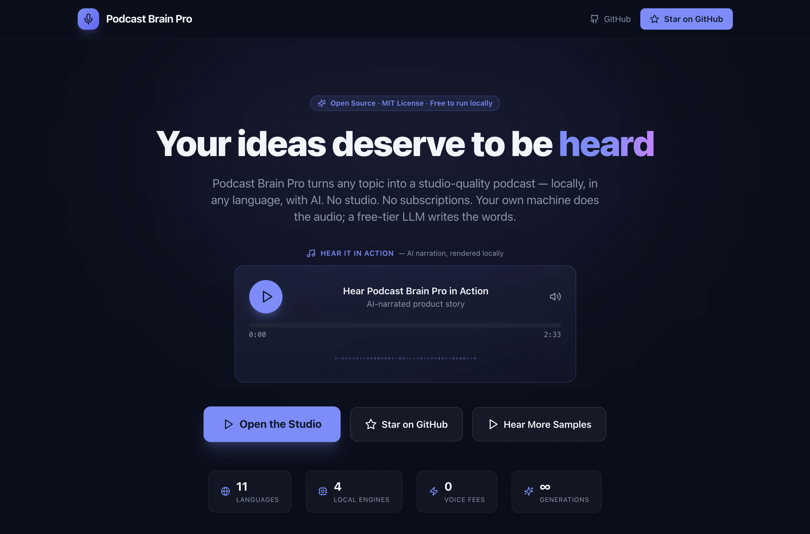
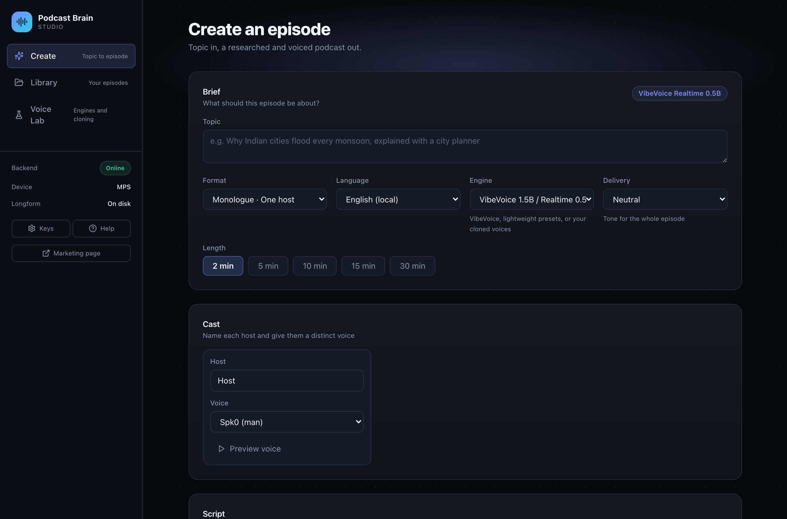
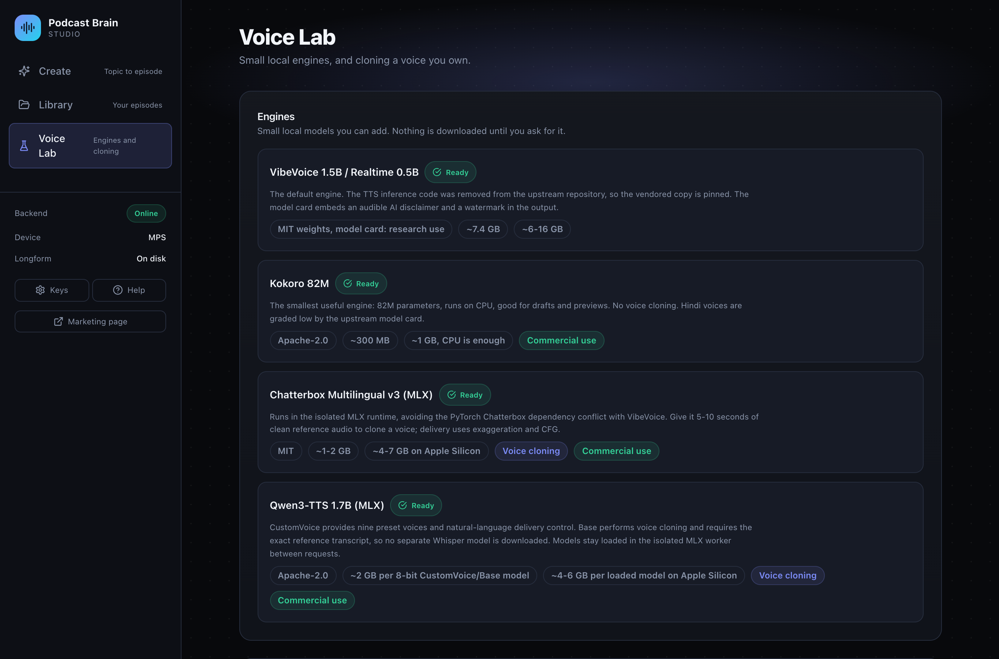
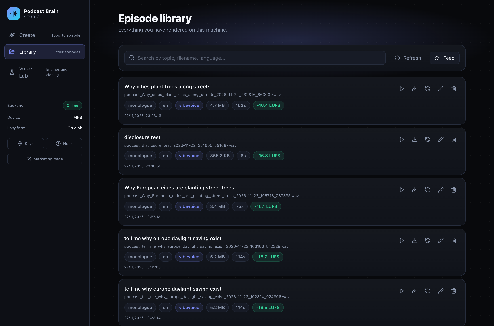
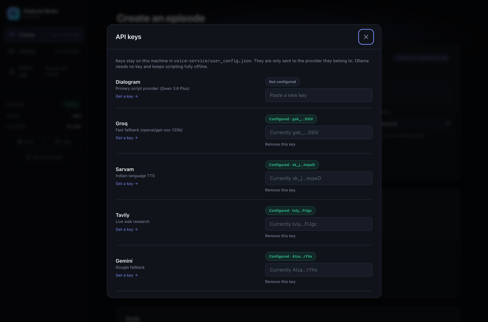
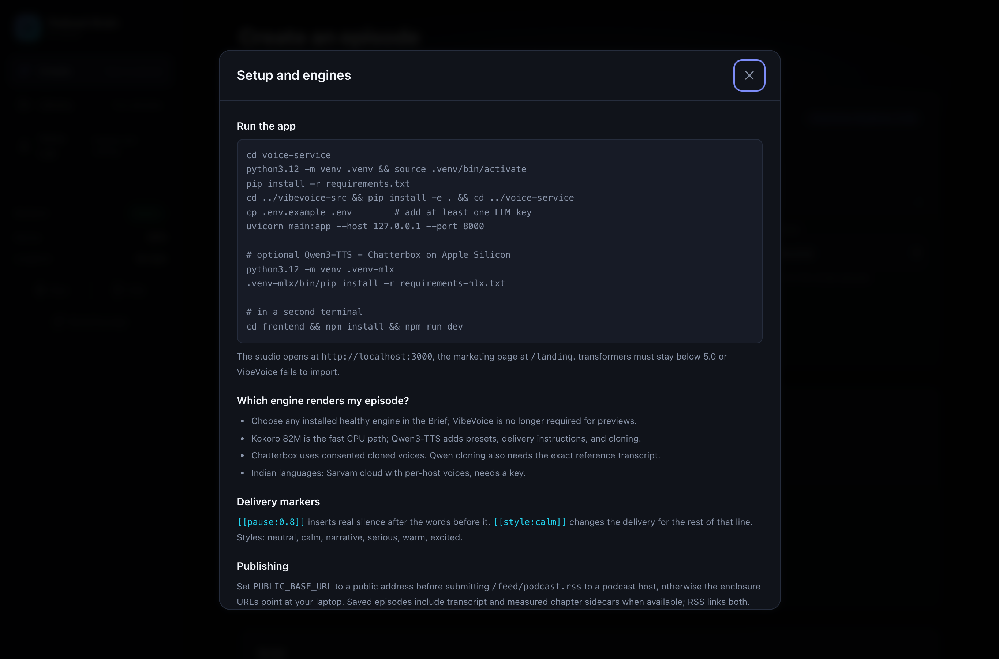
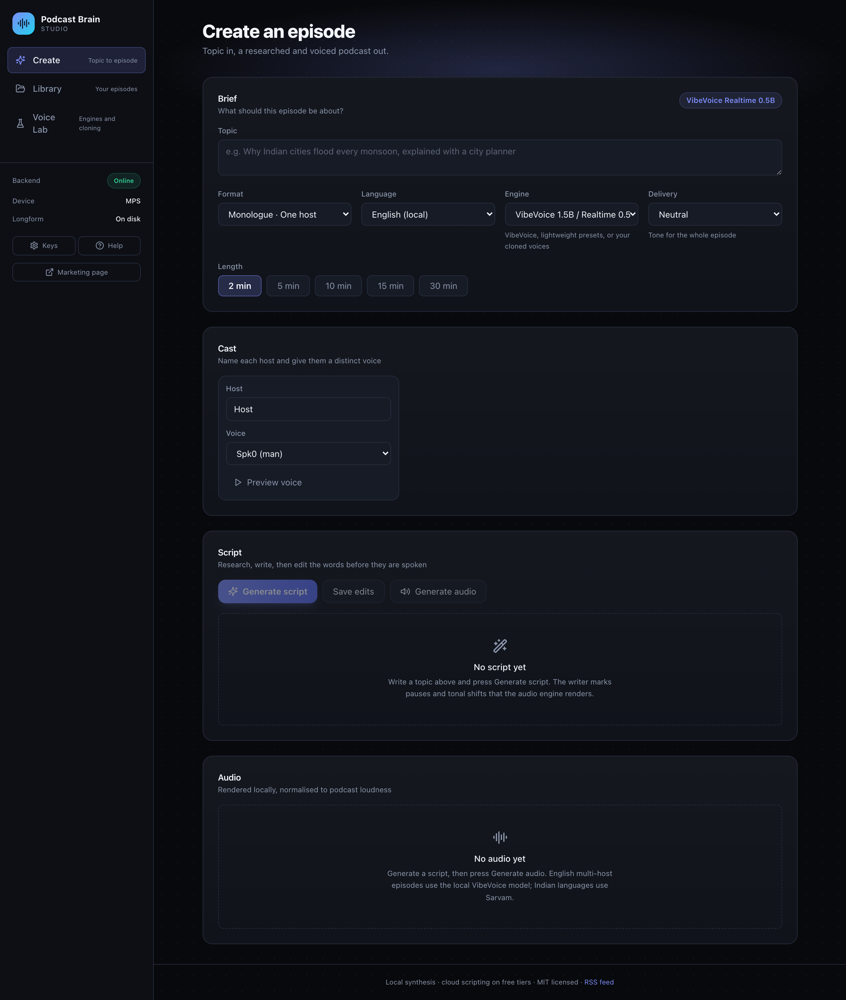

# 🎙️ Podcast Brain Pro

> Turn any topic into a studio-quality podcast — locally, in any language, with AI.

[](./LICENSE)
[](https://www.python.org/downloads/)
[](https://nodejs.org/)
[]()
[]()

[🎧 **Live Samples**](https://frontend-chi-virid-53.vercel.app/landing) · [📖 **Docs**](./docs/SETUP.md) · [⭐ **Star on GitHub**](https://github.com/niranjannie/podcast-brain-pro)

> **Note:** The [live samples page](https://frontend-chi-virid-53.vercel.app/landing) is a static demo with playable audio — for sharing and preview. The actual app runs at `localhost:3000` after local installation.

---

## Why I Built This

I spent entire weekends trying to create just one short podcast. Writing scripts. Recording again and again. Fixing mistakes. Editing endlessly.

By the time it was done, I was already exhausted.

What if creating a podcast was as simple as typing a sentence?

That's Podcast Brain Pro. An open-source AI podcast factory with local audio engines and your choice of local or cloud script generation. No studio. No required subscription.

Type a topic. Get a researched, natural script. Choose monologue, interview, or panel. Generate studio-quality audio locally. In English or 10 Indian languages.

Your ideas deserve to be heard.

---

## ✨ What It Does

| Step | What Happens | Time |
|------|-------------|------|
| 1. Enter a topic | AI researches via web search and writes a natural script | ~10–30s |
| 2. Choose format | Monologue, two-person interview, or three-person panel | Instant |
| 3. Pick language | English or 10 Indian languages | Instant |
| 4. Generate audio | Choose VibeVoice, Kokoro, Qwen3-TTS, Chatterbox, or Sarvam | Seconds–minutes by engine |
| 5. Export | WAV + transcript + show notes + chapters + RSS + JSON metadata | Instant after render |

**Languages:** English, Hindi, Kannada, Tamil, Telugu, Marathi, Bengali, Gujarati, Malayalam, Punjabi, Odia

**Output formats:** Solo monologue · Two-person interview · Three-person panel discussion

---

## 🚀 Quick Start

> **Prerequisites:** macOS Apple Silicon (M1–M4) for the MLX engines, or any machine for Kokoro on CPU · Python 3.12 recommended · Node.js 18+ · Disk space depends on the models you pick

```bash
# 1. Clone
git clone https://github.com/niranjannie/podcast-brain-pro.git
cd podcast-brain-pro

# 2. Install backend
cd voice-service
python3.12 -m venv .venv && source .venv/bin/activate
pip install -r requirements.txt
cd ../vibevoice-src && pip install -e . && cd ../voice-service
pip install kokoro  # optional fast CPU previews; needs espeak-ng

# Optional on Apple Silicon: Qwen3-TTS + Chatterbox in an isolated runtime
python3.12 -m venv .venv-mlx
.venv-mlx/bin/pip install -r requirements-mlx.txt

# 3. Configure keys
cp .env.example .env
# Add at least one LLM key. Groq and DeepSeek both have free tiers.

# 4. Start backend
source .venv/bin/activate
uvicorn main:app --host 127.0.0.1 --port 8000

# 5. Start frontend (new terminal)
cd ../frontend && npm install && npm run dev
# Open http://localhost:3000
```

Full setup guide: [`docs/SETUP.md`](./docs/SETUP.md)

---

## 🎯 What Makes It Different

- **Local audio options** — VibeVoice, Kokoro, Qwen3-TTS, and Chatterbox synthesis stays on your machine. Script research/LLM providers and Sarvam only send data when you choose them; Ollama supports local scripting.
- **10 Indian languages** — Hindi, Kannada, Tamil, Telugu, Marathi, Bengali, Gujarati, Malayalam, Punjabi, Odia. Built for multilingual creators.
- **Natural dialogue formats** — Not just reading text aloud. Interview and panel modes generate interruptions, disagreements, and follow-ups.
- **Directed delivery** — The scriptwriter marks pauses (`[[pause:0.8]]`) and tonal shifts (`[[style:calm]]`), and the audio engine renders them as real silence and a different voice setting.
- **A distinct voice per host** — Each speaker is mapped to a voice file, so two hosts never end up sharing one voice.
- **Voice Lab** — Add small local engines next to VibeVoice: Kokoro 82M (~300 MB, Apache-2.0, runs on CPU) for fast drafts, and consent-gated voice cloning with Chatterbox (MIT) or Qwen3-TTS (Apache-2.0). The catalogue tells you what is installed and whether it actually runs on your machine.
- **Production package** — Generate show notes, takeaways, five social captions, source-grounded social clips, and measured chapter markers alongside the script.
- **Revision loop** — Preview each cast member with the actual selected engine, then re-render a saved or edited script with a new cast/style without paying for another script generation.
- **Multi-host everywhere** — VibeVoice, Kokoro, Qwen3-TTS, consented Chatterbox clones, and Sarvam Indian-language conversations retain per-speaker voices and pauses.
- **Podcast ready output** — Every export is normalised to -16 LUFS, the RSS feed carries the transcript, and the episode metadata records the loudness measurement.
- **RSS feed built-in** — Generate once, publish everywhere. No extra tools needed.
- **Truly open source** — MIT licensed. Full code, full control. (The *code* is unrestricted; the VibeVoice *model* has its own licence and watermark — see [AI Disclosure](#%E2%9A%A0%EF%B8%8F-ai-disclosure).)

---

## 🎧 Live Samples (Static Demo)

Hear real episodes generated from a single sentence — zero editing:

🔗 **[https://frontend-chi-virid-53.vercel.app/landing](https://frontend-chi-virid-53.vercel.app/landing)**

> This is a static preview page for sharing on social media. The full interactive app with generation capabilities runs locally at `localhost:3000` after setup.

| Sample | Language | Format | Length |
|--------|----------|--------|--------|
| Podcast Brain Pro in Action | 🇺🇸 English | Product story | 2:33 |
| AI Future Discussion | 🇺🇸 English | Interview | 5:12 |
| Technology Trends Panel | 🇺🇸 English | Panel | 3:42 |
| Nation Building: India vs China | 🇮🇳 Hindi | Interview | 4:49 |
| Delhi Air Pollution & Government | 🇮🇳 Hindi | Panel | 4:04 |
| Bangalore News Update | 🇮🇳 Kannada | Interview | 3:04 |

---

## 🖼️ Screenshots

### Static Demo Page (for sharing)


### Actual App Interface (runs at `localhost:3000`)

**Create — the episode brief, format, language, engine and cast**


**Voice Lab — every engine, its licence, its size, and whether it clones**


**Library — search, play, rename, re-render**


**Settings Modal**


**Help & Setup Guide**


**The whole studio, including show notes, chapters and social clips**


See [`docs/screenshots/`](./docs/screenshots/) for full resolution images.

---

## 📦 Model Downloads (Automatic)

On first use of each engine, models download automatically from HuggingFace. Nothing is
fetched until you pick that engine.

| Model | Size | Time | Use Case |
|-------|------|------|----------|
| **Kokoro 82M** | ~300 MB | ~1 min | Fast CPU drafts, cast previews, social clips |
| **Qwen3-TTS 1.7B** (CustomVoice / Base) | ~2 GB each | ~3–5 min | Preset voices, delivery instructions, voice cloning |
| **Chatterbox Multilingual v3** | ~1–2 GB | ~3–5 min | Expressive consented voice cloning |
| **VibeVoice Realtime 0.5B** | ~2 GB | ~2–5 min | English monologue ≤10 min |
| **VibeVoice Longform 1.5B** | ~5.4 GB | ~5–10 min | Multi-speaker / >10 min |
| **VibeVoice ASR 7B** | ~14 GB | ~10–15 min | Speech-to-text (optional) |

**Cache:** `~/.cache/huggingface/hub/`

**Two environments, on purpose.** Kokoro and VibeVoice live in `voice-service/.venv`.
Qwen3-TTS and Chatterbox need `transformers>=5.14` while VibeVoice breaks on it, so
they live in a separate `voice-service/.venv-mlx` and are driven over a pipe by
`mlx_worker.py`. See `docs/SETUP.md`.

---

## 🏗️ Architecture

```
Topic → Web Research → LLM Script → TTS Engine → Audio + RSS
```

**Stack:**
- **Frontend:** Next.js 14 + React + Tailwind CSS
- **Backend:** FastAPI (Python)
- **Script generation:** LLM chain with Tavily web search
- **English TTS:** VibeVoice 1.5B, Kokoro 82M, Qwen3-TTS and Chatterbox (all local)
- **Indic TTS:** Sarvam AI Bulbul API
- **Output:** WAV + transcript + show notes + chapters + JSON metadata + RSS feed

```
podcast-brain-pro/
├── frontend/              # Next.js 14 + React + Tailwind
│   ├── app/page.tsx       # Studio shell
│   ├── app/landing/       # Marketing page
│   ├── components/studio/ # Create, Library, Voice Lab, Extras views
│   └── lib/useStudio.ts   # Studio state and API calls
├── voice-service/         # FastAPI backend
│   ├── main.py            # API endpoints, TTS, LLM fallbacks
│   ├── script_pipeline.py # Script contract, directives, voices, disclosure
│   ├── engines.py         # Engine registry and persistent MLX worker client
│   ├── mlx_worker.py      # Isolated Qwen3-TTS / Chatterbox runtime
│   ├── content_pipeline.py # Show notes, chapters, captions, source-grounded clips
│   ├── audio_pipeline.py  # Loudness, valid PCM stitching, duration measurement
│   ├── rss_generator.py   # RSS feed generator
│   ├── test_script_pipeline.py
│   ├── test_option_matrix.py # Exercises every option against a running backend
│   ├── start.sh           # Startup script
│   └── .env.example       # API key template
├── vibevoice-src/         # Microsoft VibeVoice (pip install -e)
├── skill/                 # Marketplace skill package
└── docs/                  # Setup, architecture, API keys, contributing
```

---

## 🔑 API Keys

Podcast Brain Pro uses a **fallback chain** of free-tier LLM providers.

**Recommended:** [Groq](https://console.groq.com/keys) (`openai/gpt-oss-20b`) or
[DeepSeek](https://platform.deepseek.com/api_keys) (`deepseek-v4-flash`) — both verified,
both with a free tier. [Dialogram](https://dialogram.me/) (`qwen-3.6-plus`) is also in the
chain, but it is a third-party router with no public API docs, so keep a second key.

**Free fallbacks:** Groq (`openai/gpt-oss-20b`), DeepSeek, Gemini, Mistral, Together AI, OpenRouter (a free model is picked from the live catalogue), plus a local Ollama model for fully offline scripting.

Every provider id can be overridden with an environment variable (`GROQ_MODEL`, `GEMINI_MODEL`, ...), so a retired model id is a one line change, not a code change.

**Indic languages:** [Sarvam AI](https://www.sarvam.ai/) — free tier for TTS (`bulbul:v3`, or `bulbul:v4-flash` for styled voices, pitch and pronunciation dictionaries)

Keys saved locally in `voice-service/user_config.json`. Never sent to our servers.

Details: [`docs/API_KEYS.md`](./docs/API_KEYS.md)

---

## ⚡ Engine Selection

| Engine | Best use | Notes |
|--------|----------|-------|
| **Kokoro 82M** | Fast drafts and cast previews | CPU, ~300 MB, English/Hindi packs |
| **Qwen3-TTS 1.7B** | Preset voices, delivery instructions, cloning | Apple Silicon MLX, 8-bit CustomVoice/Base models |
| **Chatterbox v3** | Expressive consented cloning | 23 languages through the isolated MLX worker |
| **VibeVoice Realtime 0.5B** | Existing English monologue workflow | Local PyTorch; can be slow on MPS |
| **VibeVoice Longform 1.5B** | Existing multi-host workflow | Local PyTorch; per-speaker voice presets |
| **Sarvam Bulbul** | Indian-language conversations | Cloud API, per-turn voices and delivery |

---

## 🤝 Contributing

We welcome contributions!

- [`good first issue`](../../labels/good%20first%20issue) — easy entry points
- [`help wanted`](../../labels/help%20wanted) — bigger features needing hands

Priority areas: CUDA support · Faster multi-speaker stitching · More languages · UI/UX

See [`CONTRIBUTING.md`](./CONTRIBUTING.md) and [`docs/ARCHITECTURE.md`](./docs/ARCHITECTURE.md).

---

## ⚠️ AI Disclosure

**Every episode this software produces is synthetic.** The script is written by a
language model and the voice is generated by a text-to-speech model. No human
records any part of it.

The app makes this disclosure in three places:

- **In the audio.** Every saved episode opens with a spoken line saying it was
  generated by artificial intelligence, in the episode's own language. Set
  `AI_DISCLOSURE=false` in `voice-service/.env` to turn it off — do not do that
  if you publish the episodes.
- **In the feed.** The RSS channel description, each episode description and a
  `podcast:disclosure` element all carry the same statement.
- **In the episode metadata.** Each saved episode's `.json` sidecar has a
  `disclosure` field.

This is not optional polish. **Article 50 of the EU AI Act** requires synthetic
audio to be marked as such, in a machine-readable form and with an audible
disclosure, from **2 August 2026**. If you publish episodes in the EU you are
very likely covered by it.

There is a second layer you cannot remove: the VibeVoice model card states that
the model **embeds its own audible AI disclaimer and an imperceptible watermark**
in every file it generates. That is baked into the weights. It is also why the
VibeVoice model card restricts use to research and development, and covers
English and Chinese only. If you need a commercially clean voice, use Kokoro,
Qwen3-TTS or Chatterbox instead — all of them are permissively licensed and
carry no watermark.

---

## 📄 License

[MIT License](./LICENSE) — free to use, modify, and commercialize.

---

## 🙏 Acknowledgments

- [Microsoft VibeVoice](https://github.com/microsoft/vibevoice) for the TTS models
- [Dialogram](https://dialogram.me/) for the Qwen API
- [FastAPI](https://fastapi.tiangolo.com/) and [Next.js](https://nextjs.org/) for the stack
